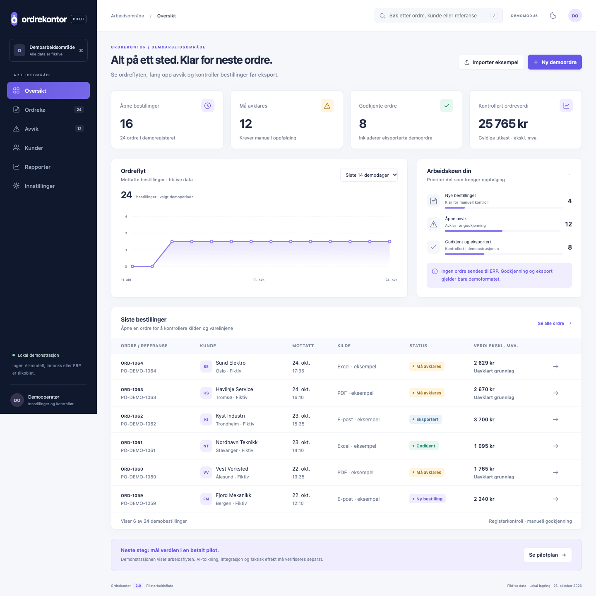

# Ordrekontor – ordre, avvik og kontroll

Interaktiv arbeidsflate for ordrebehandling der ingenting eksporteres før en manuell kontroll er utført og kvittert ut.



## Hva den gjør

Ordre kommer inn, avvik må håndteres, og noen må ta ansvar for at tallene stemmer før de forlater systemet. Prototypen modellerer hele den flyten i nettleseren:

- Ordreflyt med arbeidskø og fordeling etter status
- Registrering og oppfølging av avvik
- Register og kontroll som må gjennomgås før eksport
- Økonomisimulator der forutsetningene gir beregnet resultat
- Varelinjer og oversikt over integrasjoner
- Demodata som kan nullstilles fra grensesnittet

## Teknisk

| | |
|---|---|
| Språk | JavaScript (ES-moduler), HTML, CSS |
| Avhengigheter | Ingen |
| Tester | `node --test`, 14 tester |
| Bygg | `scripts/build-standalone.mjs` kompilerer alt til én selvstendig HTML-fil |

Applikasjonskoden ligger i `dist/`. Mappenavnet er historisk: filene der er kilden som byggeskriptet leser, ikke generert output. Byggeskriptet setter en CSP med SHA-256-hash for skriptet, slik at den ferdige enkeltfilen kjører med `script-src 'sha256-…'` uten `unsafe-inline`.

## Kom i gang

```sh
npm test     # 14 tester
npm run build   # bygger demo/Ordrekontor_demo.html
```

Åpne `demo/Ordrekontor_demo.html` direkte i nettleser. Ingen server eller installasjon kreves.

## Testing

14 av 14 tester består. JavaScript-syntakskontroll og bygging av den selvstendige HTML-filen er kjørt, og både modulutgaven og enkeltfilutgaven lastet uten JavaScript-feil i Chrome. Skjermbildet er kontrollert visuelt. Detaljer i [`VERIFISERING.md`](VERIFISERING.md).

## Begrensninger

All data er fiktiv og ligger i minnet – ingenting lagres mellom øktene. Det er ingen backend, ingen autentisering og ingen reell integrasjon mot økonomisystem. Eksporten er en demonstrasjon av flyten, ikke en produksjonsklar integrasjon.

## Lisens

MIT – se [LICENSE](LICENSE).
